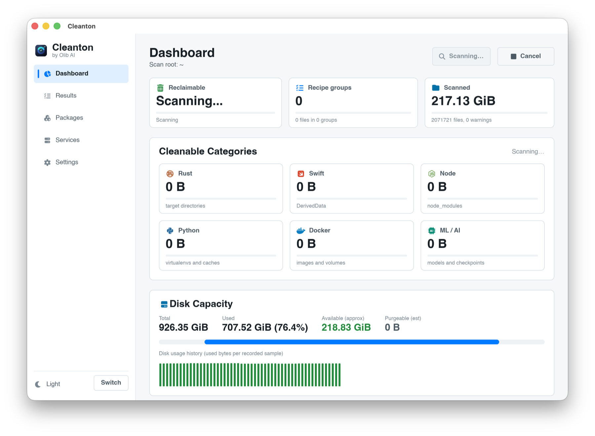
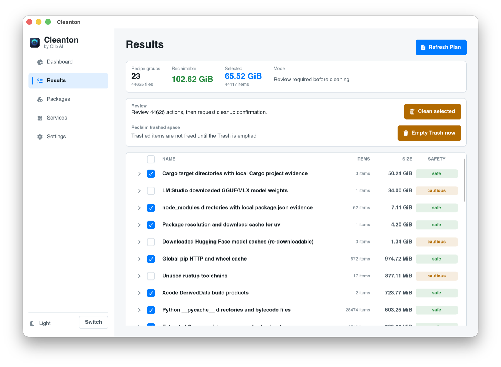
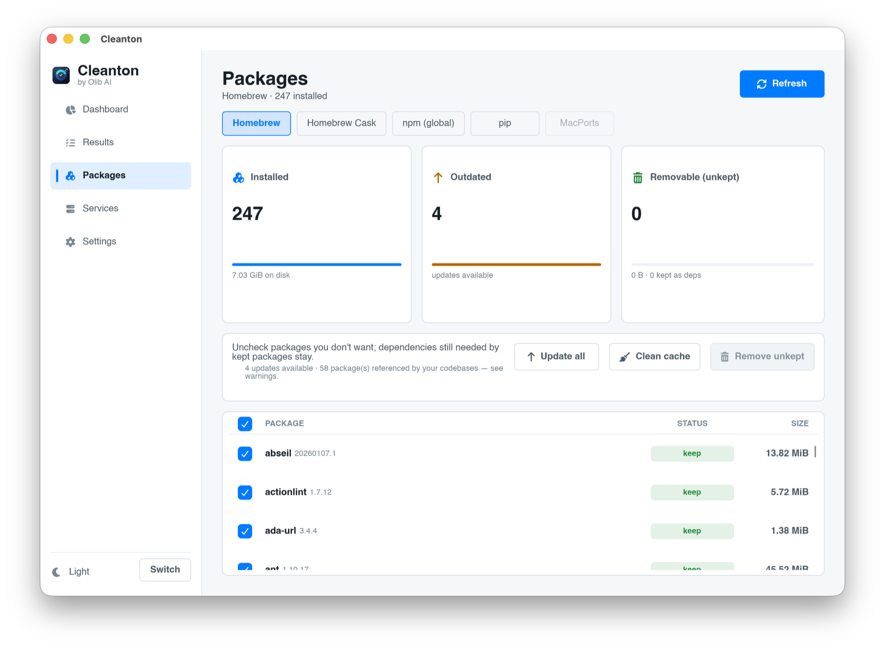
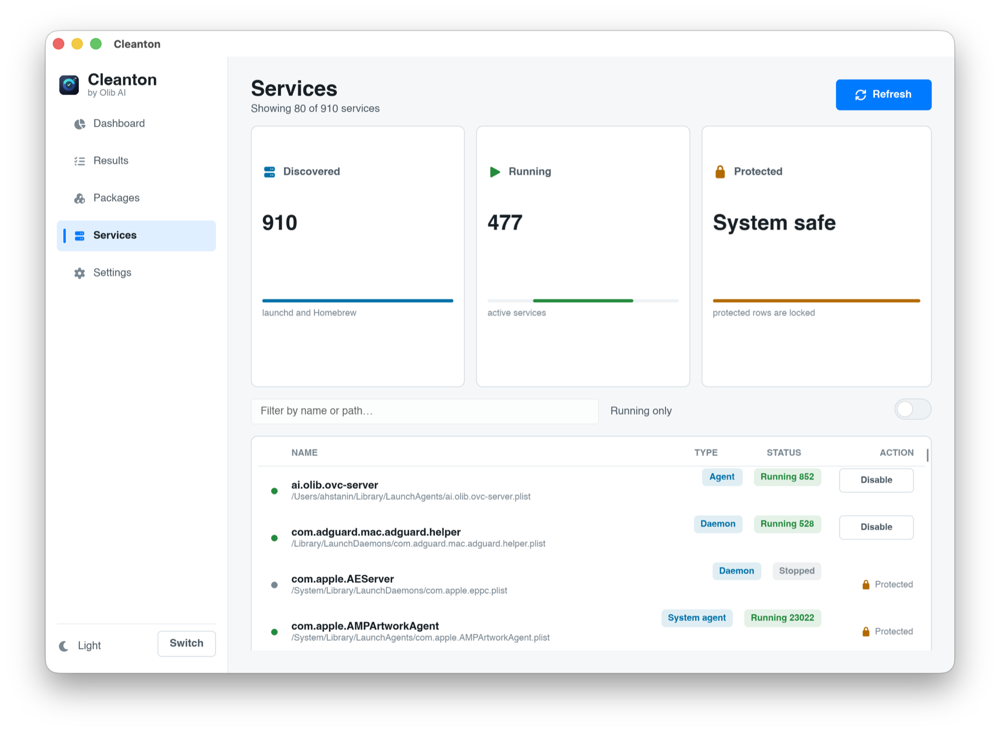

<div align="center">
  

  # Cleanton

  **A native macOS disk cleaner for developers.**

  Reclaim space from build caches, dependency folders, and other developer junk. Review everything before it is removed. Files go to the Trash by default, so a mistake is recoverable.

  [](https://github.com/Olib-AI/cleanton/releases/latest)
  [](https://github.com/Olib-AI/cleanton/releases)
  [](#is-it-safe-to-run)
  [](LICENSE)

  [Download](https://github.com/Olib-AI/cleanton/releases/latest) · [Install](#install) · [Docs](docs/) · [Safety](docs/safety.md) · [olib.ai](https://www.olib.ai)
</div>

---

## Read this first

Cleanton removes files from your disk. You decide what goes, but you are responsible for the result.

- Cleanton moves removed items to the **Trash by default**. You can recover them from the Trash until you empty it.
- Some actions can free a large amount of data at once. A full developer machine can have tens of gigabytes in build caches.
- Always read the plan before you run it. Cleanton shows every item and its size, and lets you select or skip individual entries.
- Back up anything you cannot lose. Cleanton targets caches and rebuildable artifacts, but you are the one who confirms the final list.
- The suggestions for large folders and re-downloadable repositories are for review only. Cleanton never removes those for you.

If you are not sure what an item is, skip it. Nothing is removed until you confirm.

---

## What is Cleanton?

Cleanton finds the disk space that developer tools leave behind and helps you reclaim it safely. It ships as a native macOS app and a command-line tool that share the same engine.

It knows where the space hides:

- **Rust**: `target` directories, the Cargo registry cache, incremental and sccache data
- **Node**: `node_modules`, npm and Yarn and pnpm and Bun and Deno caches, framework and deploy caches, and downloaded test browsers (Playwright, Puppeteer, Cypress)
- **JVM and Android**: Gradle caches and build outputs, the Maven repository, and Android Studio caches
- **Swift**: Xcode DerivedData, Swift Package Manager, CocoaPods, and Carthage
- **Python**: virtual environments and pip, uv, Poetry, and Conda caches
- **Go, Ruby, PHP, .NET, Dart and Flutter, Elixir, Haskell, Zig, and more**: the build and dependency caches for each
- **IDEs and editors**: JetBrains, VS Code, and Zed caches
- **Docker**: dangling images, build cache, unused volumes
- **Machine learning and AI tools**: model and checkpoint caches, Ollama and LM Studio models, and the caches left by Claude Code, Cursor, Copilot, and other assistants
- **System**: Homebrew and Xcode caches, old logs, crash reports, and Time Machine local snapshots

Then it helps you deal with the rest, and never removes any of it on its own:

- **Applications**: pick an installed app and Cleanton finds everything it leaves behind, the bundle plus its application support, caches, preferences, saved state, logs, containers, launch agents, helpers, and home-directory data like `~/.ollama`. Review each item and move it to the Trash. If the app came from a Homebrew cask, Cleanton removes it through Homebrew too. Remove an app in the Finder and Cleanton notices, then offers to clean up what it left.
- **Suggestions**: duplicate files, large folders, re-clonable git repositories (a remote and no local changes), macOS screenshots and screen recordings, and old installers left in Downloads. Surfaced for review, never removed for you.
- **Packages**: review and clean npm, pip, Homebrew, and MacPorts packages, with dependency-aware removal and a warning when a package is referenced by one of your codebases.
- **Services**: see launchd and Homebrew services and startup items, and disable or remove the ones you do not want, with system services locked as protected.

---

## Screenshots

| | |
|---|---|
| **Dashboard.** Scan your home folder and see reclaimable space by category. | **Results.** Review every group and item, with sizes and a safety rating, then select what to remove. |
|  |  |
| **Packages.** Review npm, pip, Homebrew, and MacPorts packages, with dependency-aware removal and codebase-usage warnings. | **Services.** See launchd and Homebrew services and startup items, disable or remove the ones you do not want, with system services locked. |
|  |  |

---

## Install

Cleanton is a macOS app for Apple Silicon (arm64).

### The app

1. Download `cleanton-app-macos-arm64.tar.gz` from the [latest release](https://github.com/Olib-AI/cleanton/releases/latest).
2. Extract it and move `Cleanton.app` to your Applications folder.
3. Open it. The app is signed with our Apple Developer ID and notarized by Apple, so it opens without a Gatekeeper override.

### The command-line tool

```sh
curl -fsSL https://raw.githubusercontent.com/Olib-AI/cleanton/main/scripts/install.sh | sh
```

The script downloads the latest CLI tarball, installs it to `~/.cleanton/`, and adds a `cleanton` shim to `~/.local/bin`.

> **Note on the CLI binary.** The command-line tool is signed, but it is distributed on its own rather than inside the notarized app bundle, so macOS will quarantine it the first time you download it directly. The installer script clears that flag for you. If you download the CLI tarball by hand, run `xattr -d com.apple.quarantine ./cleanton` once before the first launch, or open it once through the app bundle, which is notarized. The Cleanton app itself never needs this step.

---

## Using it

Open the app and pick a scan root (your home folder by default). Run a scan, review the grouped results, select what you want to remove, and confirm. Removed items go to the Trash.

The command-line tool mirrors the app:

```sh
# show what is reclaimable, grouped, without removing anything
cleanton plan

# run the plan after you have reviewed it (items go to the Trash)
cleanton plan --apply
```

Run `cleanton --help` for the full list of commands.

See [docs/usage.md](docs/usage.md) for the app walkthrough and the complete CLI reference, and [docs/safety.md](docs/safety.md) for exactly how Cleanton decides what is safe to remove.

---

## Is it safe to run?

Cleanton is built to be careful:

- **Trash by default.** Removed items are recoverable from the Trash. Permanent deletion is never the default.
- **Review before action.** Every scan shows the full list with sizes. You confirm the final selection.
- **Conservative targets.** Cleanton aims at caches and rebuildable artifacts. Large folders and re-clonable repositories are surfaced as suggestions only, never removed automatically.
- **Signed and notarized.** The app is signed with the Olib AI Developer ID and notarized by Apple.

That said, only you know your machine. Read [the safety guide](docs/safety.md) and the plan before you run anything.

---

## License

Cleanton is proprietary software, free to download and use. The source code is not public. You may not redistribute, resell, or reverse engineer the binaries. See [LICENSE](LICENSE) for the full terms.

---

## Links

- [Releases](https://github.com/Olib-AI/cleanton/releases) for downloads
- [Docs](docs/) for install, usage, and safety
- [Issues](https://github.com/Olib-AI/cleanton/issues) for bugs and requests
- [olib.ai](https://www.olib.ai) and [hello@olib.ai](mailto:hello@olib.ai)

<div align="center">
  <sub>Built by <a href="https://www.olib.ai">Olib AI</a></sub>
</div>
