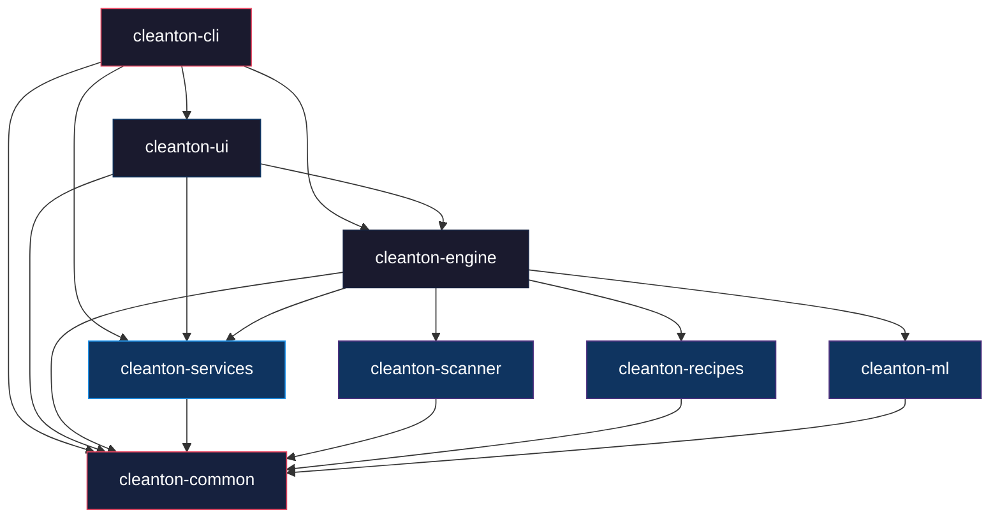

# Cleanton — Architecture Document

> **Cleanton** is a Rust-native macOS disk cleaning application that provides intelligent,
> recipe-driven cleanup of developer artifacts, ML models, container caches, and orphaned
> application files — with a modern native GUI powered by **Slint** (SwiftUI-inspired)
> and a lightweight terminal TUI powered by **ratatui** for headless/SSH environments.

---

## 1. Vision & Principles

### 1.1 Core Philosophy

| Principle | Description |
|---|---|
| **Safety First** | Every destructive operation requires explicit confirmation. Dry-run is default. Protected-path list is non-negotiable. |
| **Recipe-Driven** | Cleanup logic lives in declarative TOML recipes — users and contributors can add new patterns without touching Rust code. |
| **Intelligent Analysis** | Optional ONNX-based ML model classifies ambiguous files; heuristic engine handles everything else. Supported by a Python framework for model training. |
| **Developer-Centric** | Understands 2026-era ecosystems: build targets (`target/`, `.build/`), Python virtualenvs, Next.js/Turborepo caches, modern package managers (`uv`, `bun`, `pnpm`), local AI/ML caches (Hugging Face, Ollama, LM Studio models), local vector databases, and AI coding agent files (Claude Code, Cursor). |
| **Beautiful & Fast** | Native Slint GUI with SwiftUI-inspired design and smooth animations (primary), plus a ratatui terminal TUI for headless/SSH usage. Sub-second scan starts. |
| **Privacy-Preserving** | No telemetry, no cloud cleanup decisions, no uploading paths. Network access is forbidden in the shipped app except user-initiated update checks if a future release explicitly adds them. |

### 1.2 What Cleanton Is NOT

- Not a generic "system cleaner" — it does not touch system logs, caches managed by macOS, or active application data
- Not a duplicate file finder (though it may flag duplicate model checkpoints)
- Not a replacement for Time Machine or backup tools
- Not a malware/adware remover
- Not a root-level maintenance utility; it must run as the current user and isolate any privileged service operation to a separately confirmed subprocess
- Not an automatic "one-click delete everything" tool; even safe items are shown in a plan first

### 1.3 macOS Product Constraints

Cleanton targets modern macOS developer machines and must account for:

| Constraint | Required Behavior |
|---|---|
| TCC privacy prompts | Scanning `Desktop`, `Documents`, `Downloads`, external volumes, and parts of `~/Library` can be denied by macOS. Permission errors are first-class scan results, not crashes. |
| Full Disk Access | The app may recommend enabling Full Disk Access for more complete scans, but must work in degraded mode without it. |
| APFS clones/snapshots | Report both logical size and estimated reclaimable size when possible. Do not promise exact freed space before execution. |
| File Provider / cloud storage | iCloud Drive, Dropbox, Google Drive, OneDrive, and similar locations are cautious by default and excluded from bulk deletion unless explicitly selected. |
| External/network volumes | Removable, network, and Time Machine volumes are excluded by default. Users may opt in per root. |
| App sandboxing | A distributed `.app` build may be sandboxed or unsandboxed depending on channel. The CLI/TUI design must not require App Store-only capabilities. |

---

## 2. High-Level Architecture

```
┌─────────────────────────────────────────────────────────────────────┐
│                        cleanton (binaries)                          │
│         crates/cleanton-app (GUI)  ·  crates/cleanton-cli (CLI)     │
├──────────────────────┬──────────────┬───────────────────────────────┤
│  cleanton-app (GUI)  │ cleanton-ui  │     cleanton-cli (driver)     │
│  Slint native window │ ratatui TUI  │  clap args → orchestrator     │
│  SwiftUI-inspired    │ terminal fb  │  config loading               │
│  .slint markup       │ crossterm    │  logging (tracing)            │
├──────────────────────┴──────────────┴───────────────────────────────┤
│                      cleanton-engine (core)                         │
│  Orchestrator: scan → analyze → plan → execute pipeline             │
│  Recipe loader & validator                                          │
│  Cleanup planner (dry-run / live)                                   │
│  Safety guard (protected paths, permission checks)                  │
├─────────────────────────────────────────────────────────────────────┤
│  cleanton-scanner  │  cleanton-recipes  │  cleanton-services        │
│  parallel fs walk  │  TOML recipe defs  │  launchd/brew manager     │
│  size aggregation  │  pattern matching  │  service status & control │
├────────────────────────────┴────────────┼───────────────────────────┤
│  cleanton-ml (optional)                 │  cleanton-common          │
│  ONNX inference via ort                 │  Shared types, errors,    │
│  file classification                    │  config, paths, utilities │
└─────────────────────────────────────────┴───────────────────────────┘
```

### 2.1 Data Flow Pipeline

```
  ┌──────────┐    ┌──────────────┐    ┌──────────────┐    ┌───────────┐    ┌──────────┐
  │  SCAN    │───▶│   ANALYZE    │───▶│    PLAN      │───▶│  CONFIRM  │───▶│  EXECUTE │
  │          │    │              │    │              │    │           │    │          │
  │ Walk FS  │    │ Match recipes│    │ Build action │    │ Dry-run   │    │ Trash or │
  │ Collect  │    │ ML classify  │    │ list with    │    │ summary   │    │ delete   │
  │ metadata │    │ Score items  │    │ priorities   │    │ User OK?  │    │ Report   │
  └──────────┘    └──────────────┘    └──────────────┘    └───────────┘    └──────────┘
```

**Key invariant**: No file is ever touched until after the CONFIRM step returns user approval.

---

## 3. Crate Structure (Cargo Workspace)

The workspace is organized as a Cargo workspace with 9 crates:

```
cleanton/
├── Cargo.toml              # workspace root
├── Cargo.lock
├── crates/
│   ├── cleanton-app/       # Binary crate — native Slint GUI application
│   ├── cleanton-cli/       # Binary crate — CLI entry point & orchestrator
│   ├── cleanton-ui/        # TUI interface (ratatui)
│   ├── cleanton-engine/    # Core pipeline: scan → analyze → plan → execute
│   ├── cleanton-scanner/   # Filesystem walking & metadata collection
│   ├── cleanton-recipes/   # Recipe definitions, parsing, pattern matching
│   ├── cleanton-services/  # macOS services manager (launchd plists + Homebrew)
│   ├── cleanton-ml/        # Optional ONNX-based file classification
│   └── cleanton-common/    # Shared types, errors, config, utilities
├── recipes/                # Built-in TOML recipe files
├── models/                 # Pre-trained ONNX models (git-lfs)
├── doc/                    # This documentation
├── scripts/                # Build, release, packaging scripts
├── packaging/              # macOS .app / .dmg / Homebrew formula
├── tests/                  # Integration tests & test fixtures
└── assets/                 # FA Pro icons, fonts, UI assets
    └── icons/              # Selected FA Pro SVGs for TUI
```

### 3.1 Dependency Graph



---

## 4. Crate Details

### 4.1 `cleanton-common`

> Foundation crate — zero external dependencies beyond `serde`, `thiserror`, `tracing`.

| Item | Description |
|---|---|
| **Purpose** | Shared types, error definitions, configuration schema, path safety utilities |
| **Key Types** | `FileEntry`, `ScanResult`, `CleanupAction`, `CleanupPlan`, `RecipeId`, `Severity`, `Confidence` |
| **Config** | `CleantonConfig` — loaded from `~/.config/cleanton/config.toml` and recipe directory |
| **Safety** | `ProtectedPaths` — hardcoded + user-configurable list of paths that must never be touched |
| **Errors** | `CleantonError` enum with variants for IO, permission, recipe parsing, ML inference, etc. |

```rust
// Example core types
pub struct FileEntry {
    pub path: PathBuf,
    pub size: u64,
    pub modified: SystemTime,
    pub file_type: FileType,
    pub depth: usize,
}

pub struct CleanupAction {
    pub target: PathBuf,
    pub size_bytes: u64,
    pub recipe_id: RecipeId,
    pub action_type: ActionType,    // Trash | Delete | Archive
    pub confidence: Confidence,     // High | Medium | Low | MLInferred(f32)
    pub reason: String,
}

pub struct CleanupPlan {
    pub actions: Vec<CleanupAction>,
    pub total_reclaimable: u64,
    pub scan_duration: Duration,
    pub analysis_duration: Duration,
}
```

### 4.2 `cleanton-scanner`

> High-performance parallel filesystem walker.

| Item | Description |
|---|---|
| **Purpose** | Walk filesystem trees, collect metadata, aggregate sizes, detect project roots |
| **Key Dependencies** | `walkdir`, `ignore` (respects .gitignore), `rayon` (parallelism), `jwalk` (parallel walk) |
| **Features** | Symlink-safe traversal, `.gitignore`-as-signal (still traverses ignored dirs — see CRATES.md §2.2), hardlink-deduped sizing, project root detection (Cargo.toml, package.json, etc.) |
| **Output** | `ScanResult` containing a tree of `FileEntry` items with size aggregation |
| **Performance** | Uses `jwalk` for parallel directory walking; targets < 2 seconds for typical home directory |

**Project Root Detection**: The scanner identifies project boundaries by detecting marker files:

| Marker | Ecosystem |
|---|---|
| `Cargo.toml` | Rust |
| `Package.swift` | Swift/Xcode |
| `package.json` | Node.js |
| `pyproject.toml` / `setup.py` | Python |
| `go.mod` | Go |
| `Dockerfile` / `docker-compose.yml` | Docker |
| `*.xcodeproj` / `*.xcworkspace` | Xcode |
| `.git` | Any VCS root |

### 4.3 `cleanton-recipes`

> Declarative cleanup rule engine.

| Item | Description |
|---|---|
| **Purpose** | Define, parse, validate, and match cleanup recipes against scan results |
| **Format** | TOML recipe files with glob patterns, size thresholds, age thresholds |
| **Categories** | `rust`, `swift`, `node`, `python`, `go`, `jvm-android`, `dart-flutter`, `docker`, `ml`, `ai-tools`, `editors`, `apps`, `system` |
| **Matching** | Multi-level: directory-name → glob pattern → file extension → content sniffing |
| **Safety** | Each recipe declares a `safety_level`: `safe` / `cautious` / `aggressive` |

**Recipe example** (`recipes/rust.toml`):

```toml
[recipe]
id = "rust-target-dirs"
name = "Rust Build Artifacts"
description = "target/ directories from Cargo projects"
category = "rust"
icon = "fa-rust"                    # FA Pro icon name
safety_level = "safe"               # safe = always OK to remove
enabled = true

[match]
# Find directories named "target" that are children of a Cargo.toml
directory_name = "target"
parent_must_contain = ["Cargo.toml"]
min_size_mb = 10                    # Only flag if > 10MB

[match.exclude]
# Never match if these paths are within the target
paths = ["target/release/*.app", "target/release/*.dmg"]

[action]
type = "trash"                      # trash | delete | archive
prompt = "Remove {size} of Rust build artifacts from {project_name}?"
```

**Built-in recipe categories** (see [RECIPES.md](./RECIPES.md) for full list):

| Category | Recipes | Examples |
|---|---|---|
| **Rust** | target dirs, cargo registry cache, incremental build cache | `target/`, `~/.cargo/registry/cache` |
| **Swift / Xcode** | DerivedData, archives, device support | `~/Library/Developer/Xcode/DerivedData` |
| **Node.js** | node_modules, .next, dist, .cache | `node_modules/`, `.next/`, `.parcel-cache/` |
| **Python** | `__pycache__`, `.venv`, `.tox`, `.mypy_cache` | `__pycache__/`, `*.pyc` |
| **ML / AI** | Model checkpoints, training outputs, datasets | `*.ckpt`, `*.safetensors`, `wandb/` |
| **Docker** | Build cache, dangling images, volumes | via Docker API |
| **AI Tools** | Codex, Claude Code, Cursor, Copilot, Gemini caches/logs | tool-specific cache and log subdirectories only; never auth, config, prompts, or conversation history |
| **Apps** | Orphaned app support files, old preferences | `~/Library/Application Support/<removed_app>` |
| **System** | Developer-owned caches such as Xcode caches, Homebrew cache, CocoaPods cache | `~/Library/Caches/...`; no system logs or OS-managed stores |

### 4.4 `cleanton-engine`

> Central orchestrator — ties scanner, recipes, and ML together.

| Item | Description |
|---|---|
| **Purpose** | Pipeline orchestration: scan → analyze → plan → execute |
| **Key Components** | `Orchestrator`, `Analyzer`, `Planner`, `Executor` |
| **Analyzer** | Matches scan results against loaded recipes; optionally invokes ML for ambiguous items |
| **Planner** | Deduplicates, prioritizes, and builds the final `CleanupPlan` |
| **Executor** | Performs the actual cleanup with rollback-safe trash operations |
| **Events** | Emits `EngineEvent` for UI progress (scan progress, analysis progress, action completed) |

```rust
pub enum EngineEvent {
    ScanStarted { root: PathBuf },
    ScanProgress { files_scanned: u64, dirs_entered: u64, bytes_seen: u64 },
    ScanCompleted { result: ScanResult },
    AnalysisStarted,
    AnalysisProgress { items_analyzed: u64, total: u64 },
    AnalysisCompleted { plan: CleanupPlan },
    ActionStarted { action: CleanupAction },
    ActionCompleted { action: CleanupAction, freed: u64 },
    ActionFailed { action: CleanupAction, error: CleantonError },
    PipelineCompleted { total_freed: u64, duration: Duration },
}
```

**Concurrency model**: The engine runs on a `tokio` async runtime (justified mainly by `bollard`'s async Docker API and the channel-driven UI). The scanner uses `rayon`/`jwalk` for parallel filesystem walking. **A `rayon` walk must not run directly inside an async task — it would block the tokio reactor.** The scanner is invoked via `tokio::task::spawn_blocking` (or a dedicated thread owning the `rayon` pool) and reports progress through `tokio::sync::mpsc` channels. See [PLATFORM.md](./PLATFORM.md) §8.

### 4.5 `cleanton-ml` (Optional Feature)

> ONNX-based intelligent file classification for ambiguous cleanup decisions.

| Item | Description |
|---|---|
| **Purpose** | Classify files that don't match any recipe as "safe to remove" / "keep" / "uncertain" |
| **Runtime** | `ort` crate (ONNX Runtime wrapper) |
| **Model** | Small classification model (< 5MB), embedded in binary via `include_bytes!` |
| **Features** | File extension, size, age, path depth, parent dir name, sibling file patterns |
| **Output** | `MLClassification { label: CleanupLabel, confidence: f32 }` |
| **Fallback** | If ONNX runtime fails to load, gracefully degrades to heuristic-only mode |

**Python Training Framework**:
Model training, dataset generation, and ONNX exports are managed using a Python-based pipeline under `crates/cleanton-ml/training/`. See [ML_PIPELINE.md](./ML_PIPELINE.md) for details.

**Feature vector** (what the model sees): the canonical schema is the **12-feature** table in
[ML_PIPELINE.md](./ML_PIPELINE.md) §3.1. The Rust extractor in `cleanton-ml` and the Python
extractor in `training/features.py` must produce byte-identical vectors (zero-drift, verified by
the parity tests in `IMPLEMENTATION_PLAN.md` M8). Illustrative prefix:

```
[extension_id, size_log10, age_days, depth, parent_id,
 has_gitignore, has_lockfile, is_hidden, sibling_count,
 in_build_dir, is_source_ext, in_cache_dir]   # 12 features — see ML_PIPELINE.md §3.1
```

> **Note**: The ML model is a future enhancement. V1 will ship with heuristic-only mode.
> The crate is designed as a Cargo feature (`ml`) that can be compiled out entirely.


### 4.6 `cleanton-ui`

> Beautiful terminal UI with animated transitions, FA Pro icons, and service management view.


| Item | Description |
|---|---|
| **Purpose** | Interactive TUI for browsing scan results, previewing cleanup plans, and executing actions |
| **Framework** | `ratatui` + `crossterm` |
| **Icons** | FontAwesome Pro mapped to Nerd Font glyphs + custom SVG→halfblock renderer for key icons |
| **Animations** | Smooth progress bars, fade transitions, animated size counters, pulsing scan indicator |
| **Layout** | Multi-pane: sidebar (categories) + main (file tree) + detail (selected item info) + status bar |

**UI Screens**:

1. **Dashboard** — Overview of disk usage, quick-scan results, category breakdown with animated donut chart
2. **Scanner** — Live scan progress with animated file count, directory depth, and bytes scanned
3. **Results** — Tree view of flagged items grouped by recipe/category, with size bars and confidence badges
4. **Plan Review** — Final cleanup plan with total savings, action list, safety indicators
5. **Execution** — Progress bar per action, live freed-space counter, success/failure indicators
6. **Settings** — Recipe toggles, scan roots, protected paths, ML toggle

**Icon Strategy** (FA Pro):

The app embeds a curated set of ~50 FA Pro SVG icons converted to a custom format:
- **Primary**: Nerd Font codepoint mapping (works in any Nerd Font terminal)
- **Enhanced**: `resvg` → halfblock rendering for hero icons on the dashboard
- See [ICONS.md](./ICONS.md) for the full icon mapping table

### 4.7 `cleanton-cli`

> Binary crate — CLI argument parsing, config loading, and app entry point.

| Item | Description |
|---|---|
| **Purpose** | `main()` entry point, CLI argument parsing, config resolution, mode dispatch |
| **Modes** | `interactive` (default, launches TUI), `scan` (headless scan + report), `clean` (headless execute), `recipe` (manage recipes) |
| **Args** | `--root <path>`, `--recipe <id>`, `--dry-run`, `--json`, `--no-ml`, `--verbose` |
| **Config** | Merges CLI args → env vars → config file → defaults |

```
USAGE:
    cleanton [OPTIONS] [COMMAND]

COMMANDS:
    scan        Scan directories and report findings (no cleanup)
    clean       Execute cleanup (requires confirmation unless --yes)
    recipes     List, validate, or create recipes
    config      Show or edit configuration
    interactive Launch the TUI (default)

OPTIONS:
    -r, --root <PATH>       Root directory to scan [default: ~]
    -R, --recipe <ID>       Run only specific recipe(s)
    -n, --dry-run           Show what would be cleaned without doing it
    -j, --json              Output results as JSON
    -y, --yes               Skip confirmation prompts
        --no-ml             Disable ML classification
    -v, --verbose           Increase log verbosity
    -q, --quiet             Suppress all output except errors
    -h, --help              Print help
    -V, --version           Print version
```

### 4.8 `cleanton-services`

> macOS background service manager for LaunchAgents, LaunchDaemons, and Homebrew Services.

| Item | Description |
|---|---|
| **Purpose** | Inspect, start, stop, restart, enable, disable, and clean up plist files of macOS services |
| **Integrations**| macOS native `launchd` (LaunchAgents, LaunchDaemons) + Homebrew Services |
| **Output** | `Service` configurations, status updates, control command results |
| **Safety** | Immutable system-critical launchd configurations (e.g. `com.apple.*` are blocked from modification) |

---

## 5. Safety Model

Safety is the single most critical aspect of a disk cleaner. Cleanton implements defense-in-depth:

### 5.1 Protected Paths (Hardcoded — Cannot Be Overridden)

The complete denylist lives in [SAFETY.md](./SAFETY.md). Representative entries:

```
/System/
/Library/
/usr/
/bin/
/sbin/
/private/
/etc/
/var/
~/.ssh/
~/.gnupg/
~/.aws/
~/.kube/
~/.config/cleanton/   (own config!)
~/Library/Keychains/
~/Library/Messages/
~/Desktop/
~/Documents/
~/Downloads/
```

### 5.2 Protected Paths (User-Configurable)

Users can add paths to `~/.config/cleanton/config.toml`:

```toml
[safety]
protected_paths = [
    "~/Documents/important-project/",
    "~/critical-data/",
]
```

### 5.3 Safety Levels

| Level | Meaning | Examples | Confirmation |
|---|---|---|---|
| `safe` | Always OK to remove; regenerable build artifacts | `target/debug/`, `node_modules/`, `__pycache__/` | Single confirm |
| `cautious` | Likely safe but may contain user data | ML checkpoints, Docker volumes | Item-level confirm |
| `aggressive` | Could cause data loss; power-user only | Orphaned app data, old datasets | Double confirm + dry-run first |

### 5.4 Execution Safety

1. **Dry-run default**: All headless operations default to `--dry-run`
2. **Trash preferred**: Default action is `trash` (recoverable) not `delete`
3. **Size guard**: Refuses to delete > 50GB in a single run without `--force`
4. **Symlink safety**: Never follows symlinks during deletion; symlinks themselves can be removed
5. **Race condition protection**: Re-validates target metadata immediately before execution and relies on `std::fs::remove_dir_all` symlink behavior on supported macOS targets
6. **Rollback log**: Every execution writes a log to `~/.config/cleanton/logs/` with paths, timestamps, metadata fingerprints, and action outcomes

---

## 6. Configuration

### 6.1 Config File Location

```
~/.config/cleanton/
├── config.toml         # Main configuration
├── recipes/            # User-defined recipes (merged with built-in)
├── logs/               # Execution logs
└── cache/              # Scan result cache
```

### 6.2 Config Schema

```toml
[general]
default_root = "~"
auto_scan_on_launch = true
theme = "dark"                  # dark | light | auto
animation_speed = "normal"      # slow | normal | fast | off

[scanning]
max_depth = 20
follow_symlinks = false             # scan-only option; deletion still never follows symlinks
respect_gitignore = true         # use .gitignore as a regenerability *signal* only;
                                 # the walker still ENTERS ignored dirs (that's where the
                                 # waste lives) — see CRATES.md §2.2 rule 3
parallel_threads = 0            # 0 = auto-detect CPU count
exclude_patterns = [".Trash", ".Spotlight-*", ".fseventsd"]
exclude_cloud_roots = true
exclude_external_volumes = true

[safety]
default_action = "trash"        # trash | delete | archive
max_single_run_gb = 50
max_single_action_gb = 20
require_confirmation = true
protected_paths = []
require_full_path_review_for = ["cautious", "aggressive"]

[ml]
enabled = false                 # Opt-in for V1
model_path = ""                 # Empty = use embedded model
confidence_threshold = 0.85     # Only act on ML results above this

[ui]
show_hidden_files = false
sort_by = "size"                # size | name | age | confidence
group_by = "category"           # category | recipe | directory
icon_mode = "nerd-font"         # nerd-font | unicode | ascii
```

---

## 7. Technology Stack

### 7.0 Rust Toolchain, Edition & Lint Policy

For a tool whose failure mode is *destroying user data*, the toolchain and lint gates are part
of the safety model, not a style preference. They are **non-negotiable build gates** (enforced in
CI per `IMPLEMENTATION_PLAN.md` M1).

| Setting | Value | Rationale |
|---|---|---|
| **Pinned toolchain** | `1.96.0` (stable) — the latest stable | Pinned via `rust-toolchain.toml` (`channel = "1.96.0"`, `components = ["rustfmt", "clippy"]`) so every machine and CI runner builds bit-for-bit identically. |
| **MSRV** | `1.96.0` | `rust-version = "1.96.0"` is set in the workspace `Cargo.toml`; raising it is a deliberate, documented change. |
| **Edition** | `2024` | Stable since 1.85; chosen for a 2026 codebase (improved `unsafe`/lifetime ergonomics, RPIT lifetime capture). |
| **Profiles** | `release` with `lto = "thin"`, `codegen-units = 1`, `panic = "abort"`; `dev` keeps `panic = "unwind"` so tests can assert panics | Smaller, faster binary; `abort` in release avoids unwinding across the FFI boundaries in `cleanton-scanner`/`cleanton-services`. |

**Memory safety.** `unsafe_code` is **`deny`** at the workspace level
(`[workspace.lints.rust] unsafe_code = "deny"`) — deliberately `deny`, not `forbid`, because
`forbid` cannot be locally overridden. The single audited FFI module that genuinely needs
macOS syscalls — `cleanton-scanner/src/capacity_ffi.rs` (`statfs`/`f_bavail`, `pathconf`
volume case-sensitivity) — carries a documented file-level `#![allow(unsafe_code)]` with a
justification header, and every `unsafe` block in it carries a `// SAFETY:` comment. That
audited allow is the **only** exception. `cleanton-common`, `cleanton-recipes`,
`cleanton-engine`, `cleanton-services`, and `cleanton-ui` contain **zero** `unsafe`.

**Lints (workspace-wide, deny in CI).** Configured once in the root `Cargo.toml`
`[workspace.lints]` and inherited by every crate (`lints.workspace = true`); CI runs
`cargo clippy --all-targets --all-features -- -D warnings`:

```toml
[workspace.lints.rust]
unsafe_code            = "deny"   # forbid would block the audited capacity_ffi.rs allow
missing_debug_implementations = "warn"
unreachable_pub        = "warn"
rust_2024_compatibility = "warn"

[workspace.lints.clippy]
all      = { level = "deny", priority = -1 }
pedantic = { level = "warn", priority = -1 }
# Destructive-tool hardening — these are denied, not warned:
unwrap_used       = "deny"   # no silent panics in a deleter
expect_used       = "deny"   # (test code is exempt via #[cfg(test)] allow)
panic             = "deny"
indexing_slicing  = "deny"   # bounds-panics on attacker-influenced paths
unwrap_in_result  = "deny"
dbg_macro         = "deny"
todo              = "deny"
unimplemented     = "deny"
```

**Disallowed methods (`clippy.toml`) — the deletion choke-point.** Raw filesystem-mutating and
process-spawning calls are banned everywhere except their one vetted home, so destructive
behavior cannot leak out of the audited path:

```toml
# clippy.toml
disallowed-methods = [
  # All removal must go through cleanton-engine::executor (Trash-first, logged, revalidated).
  { path = "std::fs::remove_dir_all", reason = "use the audited Executor; never delete directly" },
  { path = "std::fs::remove_dir",     reason = "use the audited Executor" },
  { path = "std::fs::remove_file",    reason = "use the audited Executor" },
  # Shelling out is confined to cleanton-services (launchctl/brew) with structured handling.
  { path = "std::process::Command::new", reason = "only cleanton-services may spawn processes" },
]
```

A `#[allow(clippy::disallowed_methods)]` with justification is permitted **only** inside
`cleanton-engine::executor` and `cleanton-services`. `rustfmt.toml` pins formatting
(`edition = "2024"`, `max_width = 100`, `imports_granularity = "Crate"`, `group_imports = "StdExternalCrate"`)
and `cargo fmt --check` is a CI gate.

### 7.1 Core Dependencies

| Crate | Version | Purpose |
|---|---|---|
| `tokio` | 1.x | Async runtime for pipeline orchestration |
| `rayon` | 1.x | CPU-parallel filesystem walking |
| `jwalk` | 0.8+ | Parallel recursive directory walker |
| `walkdir` | 2.x | Sequential walker (fallback / simple cases) |
| `ignore` | 0.4+ | `.gitignore`-aware file matching |
| `glob` | 0.3+ | Glob pattern matching for recipes |
| `serde` / `toml` | 1.x / 0.8+ | Recipe and config deserialization |
| `clap` | 4.x | CLI argument parsing with derive macros |
| `tracing` | 0.1+ | Structured logging |
| `thiserror` | 2.x | Error type derivation |
| `trash` | 5.x | macOS Trash integration (safe deletion) |
| `ratatui` | 0.29+ | Terminal UI framework |
| `crossterm` | 0.28+ | Terminal backend for ratatui |
| `tui-big-text` | 0.7+ | Large animated text widgets |
| `indicatif` | 0.17+ | Progress bars (headless mode) |
| `humansize` | 2.x | Human-readable file sizes |
| `chrono` | 0.4+ | Timestamp formatting |
| `directories` | 5.x | XDG/macOS config directory resolution |
| `ort` | 2.x | ONNX Runtime (optional, behind `ml` feature) |
| `ndarray` | 0.16+ | Tensor manipulation (optional, behind `ml` feature) |
| `resvg` | 0.44+ | SVG → raster for icon rendering (optional) |
| `color-eyre` | 0.6+ | Pretty error reporting |
| `bollard` | 0.18+ | Docker Engine API client (for Docker cleanup) |

Dependency versions are planning targets, not pinned guarantees. Before implementation, check current crate maintenance status, each crate's MSRV (must build under our pinned **Rust 1.96.0 / edition 2024**, §7.0), transitive native dependencies, Apple Silicon support, and license compatibility.

### 7.2 Build & Tooling

| Tool | Purpose |
|---|---|
| `cargo-nextest` | Fast test runner |
| `cargo-llvm-cov` | Coverage reporting |
| `cargo-deny` | License & vulnerability auditing |
| `dist` (formerly `cargo-dist`) | Binary distribution, signing, notarization & packaging. Renamed to `dist`; still maintained as a standalone CLI. Verify current macOS notarization support at implementation time (see [PLATFORM.md](./PLATFORM.md) §3). |
| `taplo` | TOML formatting & validation |

---

## 8. Development Phases

### Phase 1 — Foundation (MVP)

- [ ] Workspace setup with all 9 crates
- [ ] `cleanton-common`: core types, errors, config
- [ ] `cleanton-scanner`: parallel FS walk with project root detection
- [ ] `cleanton-recipes`: TOML recipe parser + 10 built-in recipes (Rust, Node, Python, Swift, Docker)
- [ ] `cleanton-engine`: basic scan → analyze → plan → execute pipeline
- [ ] `cleanton-cli`: headless `scan` and `clean` commands
- [ ] `cleanton-ui`: basic TUI with dashboard + results + execution screens
- [ ] Integration tests with fixture directories

### Phase 2 — Polish

- [ ] Full recipe library (30+ recipes covering all categories)
- [ ] Animated TUI: progress animations, donut chart, size counters
- [ ] FA Pro icon integration (Nerd Font mapping + halfblock hero icons)
- [ ] Docker cleanup via `bollard` API
- [ ] AI tool cache cleanup (Codex, Claude Code, Cursor)
- [ ] Orphaned app detection (compare installed apps vs Library data)
- [ ] Scan result caching for instant re-analysis
- [ ] JSON output mode for scripting

### Phase 3 — Intelligence

- [ ] `cleanton-ml`: ONNX model training pipeline (Python)
- [ ] Feature extraction from filesystem metadata
- [ ] Model embedding and inference in Rust
- [ ] Confidence-based UI badges (green / yellow / red)
- [ ] Learning from user decisions (accept/reject feedback loop)

### Phase 4 — Distribution

- [ ] Homebrew formula
- [ ] macOS .dmg packaging
- [ ] GitHub Releases with `dist` (formerly `cargo-dist`) — signed, notarized, stapled
- [ ] Website & documentation
- [ ] CI/CD pipeline (GitHub Actions)

---

## 9. References

- [llm-cleanup](https://github.com/Olib-AI/llm-cleanup) — Sibling project, reference for TUI patterns
- [ratatui](https://ratatui.rs) — TUI framework
- [ort](https://github.com/pykeio/ort) — ONNX Runtime for Rust
- [trash-rs](https://github.com/Byron/trash-rs) — Safe macOS Trash integration
- [FontAwesome Pro](https://fontawesome.com) — Icon library (licensed)
